[GitHub](https://github.com/Soham-18shinde) &nbsp;·&nbsp;
[Portfolio](https://github.com/Soham-18shinde/PortFolio-Website)

> Computer Science & Engineering student, Pune, India.
> I like building practical products and exploring new technologies.

Currently focused on full-stack development with Next.js, React, TypeScript, Node.js, and API integrations. I am also exploring AI-powered applications and cloud technologies.

<samp>typescript &nbsp; javascript &nbsp; react &nbsp; next.js &nbsp; node.js &nbsp; express &nbsp; mongodb &nbsp; python &nbsp; c++ &nbsp; tailwind &nbsp; firebase &nbsp; git</samp>

**[MedLink](https://github.com/Soham-18shinde/medlink)** &nbsp;·&nbsp; <samp>next.js, typescript, OCR</samp> 
Prescription workflows and OCR-assisted medicine extraction for a medical ordering platform.

**[DrishtiX](https://github.com/Soham-18shinde/DrishtiX)** &nbsp;·&nbsp; <samp>next.js, react</samp> 
An idea-sharing platform built around discovering and developing concepts.

**[RecoverOS](https://github.com/Soham-18shinde/recoveros)** &nbsp;·&nbsp; <samp>python, fastapi, postgresql</samp> 
A recovery-focused project with an API-driven backend.

**[Portfolio Website](https://github.com/Soham-18shinde/PortFolio-Website)** &nbsp;·&nbsp; <samp>web, javascript</samp> 
A showcase of my web development work.

All profile graphics are generated in this repository. The ASCII portrait is linked separately rather than embedded in the page. A scheduled GitHub Action uses GitHub's GraphQL API to refresh the contribution, streak, language, and year graphics once a day, and regenerates the portrait from your GitHub avatar. The SVGs use built-in animation and do not depend on third-party stat-image services.

🏆 Top 15 finalist — National Hackathon  
🏆 Top 20 finalist — PCU Ideathon 3.0

---

*“The more you explore, the more you find out.”*

